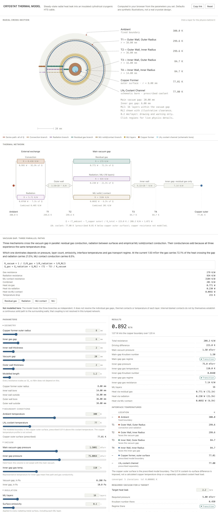

# Cryostat Thermal Model
Steady-state radial heat leak into an insulated cylindrical cryogenic HTS cable.
https://i-askari.github.io/cryostat-heat-leak-model/

[](docs/assets/application.png)

*The application at its illustrative defaults; select the image to view it at full size.*

## Overview

I developed a steady-state radial thermal-resistance model to investigate heat
leak into an insulated cylindrical cryogenic HTS cable. The original model was
written in Python; the interactive application was developed with coding assistance.

The main question is how cryostat geometry, vacuum pressure, and multilayer
insulation (MLI) affect heat leak, and what main vacuum pressure is needed to
meet a chosen heat-leak target. The model can calculate heat leak at a selected
pressure or search for a pressure that meets the target. The default target of
2.2 W/m and the other public inputs are illustrative, not requirements for a
real cryostat.

## Physical Model

The model follows heat from the ambient environment through an outer aluminum
wall, a vacuum gap with MLI, an inner aluminum wall, and an inner gas gap to the
copper former. The copper former surrounds a schematic LN₂ coolant channel.
Heat reaches the outer wall by convection and radiation.

The main vacuum gap has three parallel heat-transfer paths: residual-gas
conduction, radiation, and empirical MLI solid/contact conduction. The inner gap
has its own pressure and is modeled with gas conduction. Cylindrical thermal
resistances describe conduction through the aluminum walls and gas gaps.

The heat rate through the modeled length is

```text
Q = (T_ambient − T_copper outer surface) / R_total
```

The heat leak per unit length is `Q/L`, in W/m. By default, the LN₂ temperature
is 77.00 K and the copper outer surface is prescribed at 77.01 K. The 0.01 K
difference is an assumption, not a calculated copper temperature drop; the
modeled network ends at the copper surface.

## Interactive Application

The application lets users adjust cryostat geometry, vacuum pressures,
temperatures, MLI layers, and material properties to investigate their effects
on heat leak.

An interactive cross-section illustrates the heat-transfer mechanisms. The
thermal-resistance network and plots show how heat leak and interface
temperatures respond to the selected parameters; the inverse lookup searches
for the main vacuum pressure needed to meet a selected target.

## Numerical Method and Verification

The model uses an iterative numerical solver to calculate heat flow and
interface temperatures. Pressure and MLI sweeps show how vacuum conditions and
insulation influence the result.

The numerical implementation has been checked using analytical calculations,
independent synthetic reference cases, and heat-flow conservation tests. These
checks support mathematical consistency and implementation, but they do not
establish physical accuracy. The model has **not been experimentally validated**.

## Assumptions and Limitations

The model assumes steady-state, one-dimensional radial heat flow and uses
simplified descriptions of residual-gas conduction and MLI. The empirical MLI
contact model does not resolve its coupling to the surrounding walls. The model
neglects axial and structural heat leaks, inner-gap radiation, transient effects,
and coolant flow. Copper conduction is not calculated explicitly; the copper
outer-surface temperature is prescribed. See the [physics notes](docs/PHYSICS.md)
for the complete assumptions and limitations.

## Running Locally

No package installation or build step is needed to run the application. From
the repository directory, start a local server:

```sh
python3 -m http.server 8000 --bind 127.0.0.1
```

Open <http://127.0.0.1:8000/> in a browser. With Node.js 18+ and Python 3.9+,
run the tests and release checks with:

```sh
node tests/run.js
python3 -B -m unittest discover -s tests -p 'test_*.py'
python3 scripts/check_release.py
```

The release check is a screening tool; it does not replace a human privacy and
provenance review.

## Technical Documentation

- [Physics](docs/PHYSICS.md) — governing equations, assumptions, and limitations.
- [Validation](docs/VALIDATION.md) — numerical verification and testing.
- [Architecture](docs/ARCHITECTURE.md) — model implementation and application structure.
